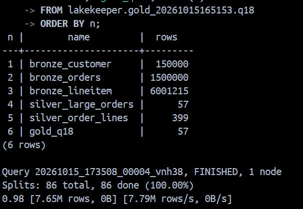
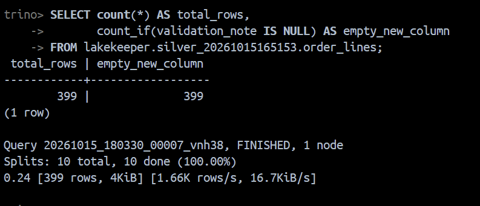
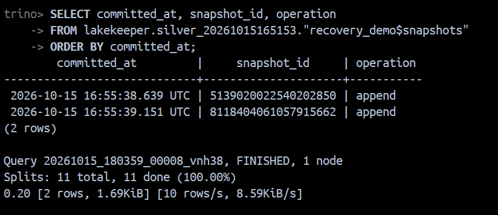

# Практическая работа №1

Репозиторий: [J043R/VK_prac_1](https://github.com/J043R/VK_prac_1)

Развертывание локального Lakehouse, ELT-преобразование и бенчмарк форматов/сжатия

Эксперимент `20261015165153`, масштаб `tpch.sf1`. Измерения и результаты проверок сохранены в `results/`.

## 1. Вариант и масштаб

| Поле | Значение |
|---|---|
| Студент | Ладыгин Максим Александрович |
| Вариант | 3, Q18 «Large Volume Customer» |
| Масштаб | tpch.sf1 |
| Причина выбора | Используется локальный стенд с 15,2 ГБ ОЗУ. Для выполненного эксперимента выбран sf1; при sf1 таблица lineitem содержит около 6 млн строк. Такой объём позволяет проверить соединения и агрегации и сохранить несколько копий Bronze. Во всех слоях и вариантах сжатия масштаб одинаков. Увеличение масштаба требует нового полного запуска и проверки ресурсов. |

Задача Q18: найти заказы, где сумма количества товара по позициям **строго больше 300**, соединить их с клиентами, вывести стоимость заказа и суммарное количество, отсортировать по стоимости по убыванию и дате по возрастанию, взять не более 100 строк. Это топ заказов с данными клиентов: один клиент может встречаться несколько раз. `totalprice` уже относится ко всему заказу, поэтому суммировать её по позициям нельзя. При равных стоимости и дате добавлен `orderkey` для воспроизводимого порядка.

Измерения выполнены на sf1 в локальном окружении; для объёма 50 ГБ и промышленного кластера потребуются отдельные замеры.

## 2. Поднятые сервисы и причины выбора

Следующая таблица описывает конфигурацию проекта. Факт запуска подтверждается `results/docker-ps.jsonl`, версиями `results/docker-images.json` и `results/environment.json` после выполнения.

| Сервис | Роль | Почему выбран |
|---|---|---|
| MinIO, исходники RELEASE.2025-04-22T22-12-26Z | S3-совместимое объектное хранилище | Позволяет локально использовать S3 без облачной учётной записи; в отличие от отдельных папок каждого движка, даёт Trino и Spark общее объектное хранилище. Образ собран из официальных исходников. |
| PostgreSQL 17.4 | База каталога Lakekeeper | Поддерживается выбранным каталогом и сохраняет его состояние в постоянном томе. Поднимать другую СУБД для этой служебной роли не требуется; строки TPC-H хранятся в MinIO. |
| Lakekeeper 0.9.5 | Iceberg REST Catalog | Общий REST-каталог позволяет Trino и Spark находить одни таблицы и согласованно фиксировать их версии. В отличие от независимого чтения файлов по пути, сохраняет сведения о схеме и текущем снапшоте. |
| Trino 476 | SQL, генератор TPC-H, ELT и замеры | Совмещает генератор tpch и работу с Iceberg: отдельный генератор dbgen и CSV-импорт не нужны. Подходит для аналитических соединений и агрегаций Q18; обычная транзакционная БД не показала бы работу двух движков с одними файлами Iceberg. |
| Spark 3.5.5, Iceberg 1.8.1 | Дополнительный движок | Читает тот же Bronze через REST и S3, считает крупные заказы. Показывает независимость Iceberg от Trino. |
| Python 3.12 | Оркестрация и сбор результатов | Стандартной библиотеки достаточно для HTTP, JSON, CSV, статистики и создания отчёта. |

Стенд разворачивается `docker compose up -d minio postgres lakekeeper trino`. Compose создаёт бакет и выполняет миграции каталога. Runner инициализирует warehouse `demo`, затем создаёт таблицы. Полные команды и последовательность запуска находятся в `run.ps1`; конфигурации - в `compose.yaml` и `config/`. Постоянные тома сохраняют данные после остановки контейнеров.

Отличие от гайда: `minio/Dockerfile` собирает сервер MinIO и клиент mc из официальных фиксированных релизов через Go 1.24.2. Проверка 15.10.2026 показала 401 при анонимном запросе к Quay и отсутствие соответствующих тегов Docker Hub. Это изменение способа получения образа, а не замена технологии хранения.

### Команды развёртывания

Команды выполняются в PowerShell из папки с `compose.yaml`:

```powershell
# Основные службы; зависимости bucket и migrate выполняют начальную настройку.
docker compose up -d minio postgres lakekeeper trino
# Загрузка Bronze, преобразования Silver/Gold, бенчмарк и демонстрация Iceberg.
docker compose run --rm runner --stage all --sf 1 --repeats 5
# Spark запускается отдельно от Trino, чтобы снизить пиковый расход памяти.
docker compose stop trino
docker compose run --rm --build spark
docker compose start trino
# Добавить результат Spark в итоговый отчёт.
docker compose run --rm runner --stage report --sf 1 --repeats 5
```

Эту последовательность с проверкой ошибок автоматизирует `run.ps1`. В `compose.yaml` указаны образы, порты, тома и зависимости; конфигурация каталога Trino находится в `config/catalog/lakekeeper.properties`. Подключение второго движка, Spark, описано в разделе 6.2.

## 3. Разбор запроса

| Таблица TPC-H | Нужные колонки | Назначение |
|---|---|---|
| customer | custkey, name | Соединение с orders по custkey, вывод имени и идентификатора клиента |
| orders | orderkey, custkey, orderdate, totalprice | Соединение с клиентом и позициями, группировка, сортировка и вывод |
| lineitem | orderkey, quantity | Подзапрос GROUP BY orderkey HAVING sum(quantity)>300 и итоговая сумма количества |
| lineitem | linenumber (дополнительно в Silver) | Сохранение уникального ключа позиции и контроль отсутствия дублей |

SQL использует имена коннектора Trino без префиксов `c_`, `o_`, `l_`. Источник - детерминированный TPC-H, а не реальные персональные данные.

## 4. Медальон: решения по слоям

Bronze сохраняет **все колонки** трёх исходных таблиц, без фильтров и исправлений. Это позволяет повторить ELT и проверить исходный Q18. На Silver проверки обязательных полей, уникальности ключей, положительного quantity и ссылочной целостности блокируют продвижение при ошибках. Неизвестные дубли не удаляются произвольно. Нормализация включает trim(name), явные DECIMAL(18,2) для стоимости и количества, выделение ключа позиции. Обогащение - соединение имени клиента, заказа и позиций. Отдельная `large_orders` содержит все заказы с количеством >300, а `order_lines` - все их позиции. Gold агрегирует Silver и ограничивает результат топом 100.

Во всех таблицах нет партиционирования: Q18 не фильтрует даты и должен суммировать позиции всех заказов. Разбиение по дате не даст pruning для этого запроса, а разбиение по orderkey создаст слишком много малых партиций. На sf1 разумнее последовательные колоночные файлы. При другом наборе запросов и большем объёме решение нужно пересмотреть.

Iceberg - табличный формат, PARQUET/ORC - форматы файлов, ZSTD/GZIP/SNAPPY - кодеки. Они решают разные задачи.

### Bronze

| Таблица | Колонки | Строк | Данные, МиБ | Формат | Сжатие | Партиционирование | Обоснование |
|---|---|---:|---:|---|---|---|---|
| customer | все поля customer | 150000 | 7.8159 | PARQUET | ZSTD | нет | Parquet сохраняет типы и подходит обоим движкам; ZSTD сокращает объём без долгой записи GZIP; нет партиций, так как Q18 читает все заказы |
| orders | все поля orders | 1500000 | 34.9474 | PARQUET | ZSTD | нет | Parquet сохраняет типы и подходит обоим движкам; ZSTD сокращает объём без долгой записи GZIP; нет партиций, так как Q18 читает все заказы |
| lineitem | все поля lineitem | 6001215 | 147.2169 | PARQUET | ZSTD | нет | Parquet сохраняет типы и подходит обоим движкам; ZSTD сокращает объём без долгой записи GZIP; нет партиций, так как Q18 читает все заказы |

### Silver

| Таблица | Колонки | Строк | Данные, МиБ | Формат | Сжатие | Партиционирование | Обоснование |
|---|---|---:|---:|---|---|---|---|
| large_orders | orderkey, total_quantity | 57 | 0.0008 | PARQUET | ZSTD | нет | Parquet совместим с Trino/Spark; ZSTD сохраняет единый кодек подготовленного слоя; для 57/399 строк партиции создадут лишние малые файлы |
| order_lines | name, custkey, orderkey, orderdate, totalprice, linenumber, quantity | 399 | 0.0039 | PARQUET | ZSTD | нет | Parquet совместим с Trino/Spark; ZSTD сохраняет единый кодек подготовленного слоя; для 57/399 строк партиции создадут лишние малые файлы |

### Gold

| Таблица | Колонки | Строк | Данные, МиБ | Формат | Сжатие | Партиционирование | Обоснование |
|---|---|---:|---:|---|---|---|---|
| q18 | name, custkey, orderkey, orderdate, totalprice, total_quantity | 57 | 0.0027 | PARQUET | SNAPPY | нет | Parquet совместим с аналитическими инструментами; SNAPPY выбран как быстрый кодек, выигрыш в размере на 57 строках несущественен; партиции не нужны |

Размер данных - точная сумма `file_size_in_bytes` в `$files` текущего снапшота, не оценка `SHOW STATS`. 1 МиБ = 1 048 576 байт. Метаданные считаются отдельно листингом S3 `/metadata/`, включая сохранённую историю. Поэтому размер текущих файлов данных не равен общему объёму всех объектов и истории таблицы. Таблица размеров фиксируется сразу после материализации слоёв, до демонстрации изменения схемы и создания recovery_demo; эти последующие метаданные в исходные размеры не входят.

В таблице Silver перечислены колонки на момент материализации. После демонстрации в `order_lines` также присутствует `validation_note VARCHAR`; отдельная `recovery_demo` служит только для восстановления и не входит в бизнес-слои и бенчмарк. Для перевода МиБ в десятичные МБ: байты / 1 000 000.

### Первые 10 строк Gold

Полный результат — [gold.csv](results/gold.csv). Порядок: стоимость по убыванию, дата и номер заказа по возрастанию.

| Клиент | custkey | orderkey | Дата | Стоимость заказа | Количество |
|---|---:|---:|---|---:|---:|
| Customer#000128120 | 128120 | 4722021 | 1994-04-07 | 544089.09 | 323.00 |
| Customer#000144617 | 144617 | 3043270 | 1997-02-12 | 530604.44 | 317.00 |
| Customer#000013940 | 13940 | 2232932 | 1997-04-13 | 522720.61 | 304.00 |
| Customer#000066790 | 66790 | 2199712 | 1996-09-30 | 515531.82 | 327.00 |
| Customer#000046435 | 46435 | 4745607 | 1997-07-03 | 508047.99 | 309.00 |
| Customer#000015272 | 15272 | 3883783 | 1993-07-28 | 500241.33 | 302.00 |
| Customer#000146608 | 146608 | 3342468 | 1994-06-12 | 499794.58 | 303.00 |
| Customer#000096103 | 96103 | 5984582 | 1992-03-16 | 494398.79 | 312.00 |
| Customer#000024341 | 24341 | 1474818 | 1992-11-15 | 491348.26 | 302.00 |
| Customer#000137446 | 137446 | 5489475 | 1997-05-23 | 487763.25 | 311.00 |



*Количество строк в Bronze, Silver и Gold. Скриншот ручной проверки запуска `20261015165153`.*

В исходном Bronze метаданные занимают 0.5840 МиБ при 189.980 МиБ data-файлов: 0.3074% от данных. У Gold на 57 строк data-файлы занимают 2814 байт, а метаданные - 17609 байт (625.8% от данных). На маленькой витрине накладные расходы Iceberg заметны, поэтому измерять эффективность кодеков только на Gold было бы некорректно. Именно полные копии Bronze составляют базу бенчмарка.

Проверки качества: выполнено 8 проверок, число обнаруженных нарушений - 0. Источник TPC-H уже согласован, поэтому исправления грязных записей не симулируются. Нормализация типов и имени клиента, а также обогащение соединением таблиц выполнены на Silver.


## 5. Тесты производительности

Тестируется исходный Q18 над полными копиями Bronze. Каждый вариант имеет те же строки, схему и масштаб. Сравниваются PARQUET NONE/SNAPPY/GZIP/ZSTD и ORC SNAPPY/GZIP/ZSTD. Для ORC Trino отображает GZIP на сжатие ZLIB/DEFLATE; это не gzip-файл вокруг ORC. Таблицы создаются через CTAS из одной опорной копии Bronze. В Trino 476 кодек задаётся **сессионным** свойством `lakekeeper.compression_codec`, не неподдерживаемым свойством CREATE TABLE. Формат задаётся WITH (format=...).

Время записи - сумма wall-clock трёх CTAS от отправки запроса до полного получения ответа. В него входит чтение опорного Bronze, кодирование, запись и commit, но не запросы подсчёта размеров. Это один измеренный цикл загрузки, поэтому устойчивых выводов о дисперсии времени записи нет. Запросы выполняются последовательно одним движком с `task_concurrency=2`. Первый Q18 записывается отдельно; затем выполняются повторные замеры, порядок вариантов циклически сдвигается. Вычисляются медиана, минимум, максимум и выборочное стандартное отклонение. Ответ каждого запуска сравнивается с эталоном.

**Кэш:** кэш ОС/MinIO не сбрасывается, поэтому первый запуск нельзя считать гарантированно холодным. Повторные замеры характеризуют прогретое окружение. Первый запуск каждого варианта происходит после записи файлов и проверки размеров, что также влияет на кэш. Spark запускается после замеров Trino. Измерение отражает локальный стенд, а не универсальное преимущество одного кодека.

| Формат | Кодек | Запись, с | Первый Q18, с | Медиана Q18, с | Мин / макс, с | σ, с | Bronze, МиБ | Метаданные, МиБ | Файлов |
|---|---|---:|---:|---:|---|---:|---:|---:|---:|
| PARQUET | NONE | 15.235 | 4.214 | 0.650 | 0.600 / 0.793 | 0.084 | 486.336 | 0.5839 | 11 |
| PARQUET | SNAPPY | 13.923 | 0.978 | 0.731 | 0.594 / 0.827 | 0.101 | 261.239 | 0.5840 | 11 |
| PARQUET | GZIP | 32.543 | 0.840 | 0.717 | 0.639 / 0.977 | 0.133 | 184.822 | 0.5842 | 11 |
| PARQUET | ZSTD | 14.017 | 0.806 | 0.682 | 0.619 / 0.736 | 0.050 | 190.032 | 0.5836 | 11 |
| ORC | SNAPPY | 15.918 | 1.727 | 0.978 | 0.864 / 1.278 | 0.159 | 267.679 | 0.5833 | 11 |
| ORC | GZIP | 20.938 | 1.192 | 1.186 | 1.050 / 1.438 | 0.153 | 187.980 | 0.5830 | 11 |
| ORC | ZSTD | 12.624 | 1.254 | 1.110 | 0.959 / 1.271 | 0.115 | 193.751 | 0.5833 | 11 |

Повторов на вариант: 5. Все результаты совпали с эталонным Q18.

Сравнение GZIP и ZSTD: изменение размера PARQUET ZSTD относительно GZIP = 2.82%, изменение медианы времени = -4.89%. Отрицательное изменение означает уменьшение. Формула: (ZSTD/GZIP - 1) × 100%.

Сравнение Parquet GZIP/ZSTD (время — медиана пяти повторов Q18):

| Сжатие Bronze, Parquet | Время Q18, с | Bronze, МиБ | Вывод |
|---|---:|---:|---|
| GZIP | 0.717 | 184.822 | Меньший объём в этом прогоне; запись медленнее ZSTD. Подходит при приоритете экономии места. |
| ZSTD | 0.682 | 190.032 | Запись быстрее GZIP, объём немного больше. Выбран для Bronze/Silver; небольшая разница медиан Q18 сама по себе не доказывает устойчивого ускорения. |

Время записи ZSTD составило 0.431 от GZIP, то есть уменьшилось на 56.93%. Для локального учебного пайплайна оставляю ZSTD на Bronze/Silver: в измеренном прогоне небольшое увеличение объёма относительно GZIP сопровождается меньшим временем загрузки и меньшей медианой Q18. Если важен только минимальный объём и слой редко перечитывается, GZIP даёт меньший файл. Вывод о записи опирается на один цикл и требует повторения для оценки устойчивости.

Минимальный объём данных наблюдался у PARQUET/GZIP; минимальная медиана Q18 - у PARQUET/NONE. Если различия времени сопоставимы с разбросом, их нельзя трактовать как устойчивое ускорение. Предпочтение по одному критерию не означает преимущество по всем нагрузкам.


## 6. Осмысление и работа с инструментами

### 6.1. Понять и объяснить

| Вопрос | Ответ |
|---|---|
| Зачем большие данные и Lakehouse? | Lakehouse нужен при больших объёмах файлов, нескольких движках и необходимости хранить исходную историю: объектное хранилище отделяется от вычислений, а Iceberg добавляет транзакции и управление версиями. На маленькой задаче обычная БД проще и может быть быстрее. Здесь Lakehouse выбран для изучения архитектуры и общей работы Trino/Spark с одним набором файлов. |
| Schema evolution на Silver | Скрипт ADD COLUMN quality_note VARCHAR, затем RENAME COLUMN quality_note TO validation_note меняет схему по идентификаторам колонок. Проверка сравнивает список data-файлов до и после и проверяет NULL в новом поле у старых строк. Это изменение схемы без переписывания содержимого. |
| Time travel и восстановление | Сохраняется snapshot_id копии Gold в Silver.recovery_demo, добавляется одна лишняя строка, чтение FOR VERSION AS OF возвращает прежние данные. Затем ALTER TABLE ... EXECUTE rollback_to_snapshot(id) восстанавливает прежнее состояние. Полное содержимое сравнивается с копией до изменения. |

Фактическая проверка: data-файлы Silver неизменны, NULL в новом поле у 399 строк. Снапшот 5139020022540202850; строк до ошибки 57, после 58, восстановлено 57. Историческое и восстановленное содержимое совпало.

Команды SQL демонстрации изменения схемы (уже выполнены скриптом; повторно добавлять существующую колонку не нужно):

```sql
ALTER TABLE lakekeeper.silver_20261015165153.order_lines ADD COLUMN quality_note VARCHAR;
ALTER TABLE lakekeeper.silver_20261015165153.order_lines RENAME COLUMN quality_note TO validation_note;
```

Пример чтения снапшота и восстановления демонстрационной таблицы для этого запуска:

```sql
SELECT count(*)
FROM lakekeeper.silver_20261015165153.recovery_demo
FOR VERSION AS OF 5139020022540202850;

ALTER TABLE lakekeeper.silver_20261015165153.recovery_demo
EXECUTE rollback_to_snapshot(5139020022540202850);

SELECT count(*) FROM lakekeeper.silver_20261015165153.recovery_demo;
```

Исторический и восстановленный `count(*)` равны 57. При новом полном запуске имена схем и snapshot_id меняются; актуальные значения находятся в `results/pipeline.json` и `results/demo.json`.



*После изменения схемы сохранены 399 строк, новая колонка содержит NULL. Скриншот ручной проверки запуска `20261015165153`.*



*История снапшотов демонстрационной таблицы: исходная версия и добавление строки. Скриншот ручной проверки запуска `20261015165153`.*


### 6.2. Подключение Spark к Bronze

| Инструмент | Почему выбран |
|---|---|
| Spark в Docker | Проверяет взаимодействие второго движка с существующими Iceberg-таблицами. В отличие от отдельной копии CSV/Parquet, Spark получает схему и список файлов из того же REST-каталога. BI здесь потребовал бы дополнительного UI, но не показал бы независимое исполнение агрегации над Bronze. |

Скрипты: `spark/Dockerfile`, сервис spark в Compose и `scripts/spark_bronze.py`. SparkCatalog настроен на `http://lakekeeper:8181/catalog`, warehouse `demo`, S3FileIO - на `http://minio:9000`. В консоли скрипт читает три таблицы Bronze, сравнивает count(*) с Trino, группирует lineitem по orderkey, применяет HAVING >300 и показывает десять заказов. Число крупных заказов сравнивается с Silver.large_orders. Команда: `docker compose run --rm --build spark`, на этом стенде предварительно останавливается Trino, как в разделе 2. Результат сохраняется в `results/spark-bronze.json`, вывод консоли — в `results/spark-console.log`.

Spark 3.5.5 прочитал все три таблицы; количества строк совпали с Trino. Крупных заказов: 57. Десять примеров, выведенных Spark (порядок по номеру заказа):

| orderkey | total_quantity |
|---:|---:|
| 6882 | 303.0 |
| 29158 | 305.0 |
| 502886 | 312.0 |
| 551136 | 308.0 |
| 565574 | 301.0 |
| 735366 | 309.0 |
| 857959 | 305.0 |
| 967334 | 301.0 |
| 983201 | 304.0 |
| 1263015 | 320.0 |

Полный результат проверки — [spark-bronze.json](results/spark-bronze.json), вывод консоли — [spark-console.log](results/spark-console.log).

## 7. Выводы

Результат Gold на sf1 совпал с исходным Q18, проверки ключей и ссылочной целостности пройдены. Слои сохраняют исходные строки в Bronze, выделяют согласованные позиции крупных заказов в Silver и формируют итоговую витрину в Gold. В этом прогоне наименьший объём получен у PARQUET/GZIP, а минимальная медиана Q18 - у PARQUET/NONE; выбор зависит от приоритета хранения или задержки и ограничен описанной методологией. Изменение схемы сохранило data-файлы, восстановление вернуло исходное содержимое, а Spark прочитал тот же Bronze через общий каталог. Для более сильного вывода о производительности следует повторить запись, контролировать холодный кэш и проверить больший sf на более мощном стенде.


## Окружение и идентификатор эксперимента

Запуск `20261015165153` (идентификатор — время UTC); масштаб sf1. Схемы: `lakekeeper.bronze_20261015165153`, `lakekeeper.silver_20261015165153`, `lakekeeper.gold_20261015165153`. Процессор: AMD Ryzen 9 7940HS w/ Radeon 780M Graphics; логических процессоров: 16; ОЗУ компьютера: 15.2 ГБ. Окружение — Windows с Docker Desktop/WSL 2, один узел Trino; heap Trino 4 ГБ, лимит контейнера 5 ГБ, Spark запускается последовательно с Trino.
